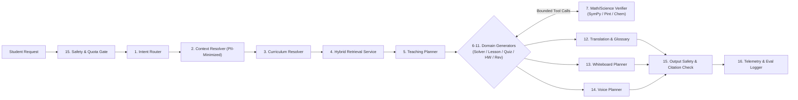

# AI Architecture (`docs/AI_ARCHITECTURE.md`)

**Philosophy:** Modular, schema-validated, curriculum-grounded, deterministically verified, child-safe, cost-metered AI orchestration. Never a single giant monolithic prompt; never uncontrolled autonomous loops.

---

## 1. Deterministic vs. Probabilistic Boundaries

| Executed Deterministically in Code (Never Delegated to LLM) | Executed by Modular AI + Tool Verification |
| :--- | :--- |
| RBAC permissions & tenant isolation | Intent classification & pedagogical mode selection |
| Assessment timers, scoring, negative/partial marking | Concept explanations, analogies, Socratic questioning |
| Subscription quotas, rate limits, billing deductions | Lesson plan structuring & whiteboard action planning |
| Spaced repetition scheduling & rule-based mastery math | Doubt resolution & graduated hint phrasing |
| Content rights & `embedding_allowed` RAG filtering | OCR work interpretation & diagnostic feedback |
| Symbolic algebra, calculus, unit & stoichiometry verification | Translation drafts (subject to glossary & human review) |

---

## 2. 16-Module AI Orchestration Pipeline

### Module Contracts (Explicit I/O, Tool Permissions & Versioning)

| # | Module | Explicit Input Schema | Explicit Output Schema | Permitted Tools |
| :-: | :--- | :--- | :--- | :--- |
| 1 | **Intent Router** | `user_message`, `surface_context`, `active_mode` | `intent` (`concept_explain\|doubt\|hint\|socratic\|lesson\|quiz_gen\|hw_help\|revision`), `confidence` | None (pure classifier/structured LLM) |
| 2 | **Context Resolver** | `student_id`, `session_id` | `AnonymizedStudentContext` (`grade`, `board`, `exam_target`, `mastery_summary`, `misconceptions`, `lang_prefs` — **zero PII**) | Read-only internal DB projection |
| 3 | **Curriculum Resolver** | `query`, `student_context`, `explicit_ids` | `board_id`, `session_id`, `grade_id`, `subject_id`, `chapter_id`, `concept_id`, `prerequisites` | `curriculum.public` read service |
| 4 | **Retrieval Service** | `query`, `curriculum_filters`, `rights_filter` | Ranked `CitedChunk[]` (`chunk_id`, `text`, `hierarchy_path`, `score`, `source_attribution`) | SQL FTS + pgvector (`embedding_allowed=true` enforced) |
| 5 | **Teaching Planner** | `intent`, `student_context`, `retrieved_chunks` | `PedagogicalPlan` (`mode` 1..10, `spoiler_guard`, `target_steps`, `reading_level`) | None |
| 6 | **Problem Solver** | `problem_text`, `plan`, `chunks` | `CandidateSolution` (`symbolic_form`, `steps[]`, `final_answer`) | Calls Module 7 only |
| 7 | **Math/Science Verifier** | `symbolic_expr`, `units`, `chem_eq`, `claim` | `VerificationResult` (`verified: bool`, `computed_value`, `unit_ok`, `counterexample`, `error`) | Sandboxed SymPy / SciPy / Pint (max 2s timeout, AST whitelist) |
| 8 | **Lesson Generator** | `concept_id`, `student_context`, `chunks` | Validated `LessonArtifact` JSON (see [CLASSROOM_ARCHITECTURE.md](file:///d:/go4guru/docs/CLASSROOM_ARCHITECTURE.md)) | Retrieval + Verifier |
| 9 | **Quiz Generator** | `quiz_config`, `chunks`, `existing_hashes` | `GeneratedQuestionDraft[]` (schema + answer verified + deduped + `ai_generated=true`) | Retrieval + Verifier + Dedup check |
| 10 | **Homework Evaluator** | `ocr_steps`, `detected_q`, `subject_discipline` | `HomeworkDiagnosis` (`error_step`, `error_type`, `hints[1..3]`, `misconception_code`) | Verifier + Retrieval |
| 11 | **Revision Planner** | `mastery_map`, `due_cards`, `exam_date`, `hours` | `StudyPlanDraft` (validated against deterministic schedule constraints) | Read-only mastery/revision |
| 12 | **Translation / Localization** | `text`, `source_lang`, `target_lang`, `glossary` | `LocalizedText` (preserves LaTeX `$...$`, units, canonical terms) | `terminology_glossary` lookup |
| 13 | **Whiteboard Planner** | `segment_narration`, `math_steps`, `diagram_intent` | Validated `WhiteboardAction[]` JSON | None (schema-checked) |
| 14 | **Voice Planner** | `narration_text`, `voice_lang`, `speed` | `TTSSegmentCue[]` (chunked for natural prosody & subtitle alignment) | Capability Registry read |
| 15 | **Safety Layer** | `raw_input` / `candidate_output`, `is_minor` | `SafetyVerdict` (`allow\|block\|safe_redirect\|escalate`, `reasons`) | Moderation rules/classifier |
| 16 | **Quality Evaluation** | `trace_id`, `inputs`, `outputs`, `citations`, `verifier` | Telemetry + async eval queue trigger | Eval DB logger |

**Loop & Cost Controls:** Maximum 2 verifier-retry cycles per turn; hard token ceiling per turn; prompt template version (`prompt_v1.2.0`) logged on every `ai_messages` row.

---

## 3. Pedagogical Teaching Modes & Anti-Spoiler Policy

Supports 10 explicit modes: `Explain`, `Hint`, `Socratic`, `Step-by-step`, `Practice`, `Exam Prep`, `Revision`, `Advanced`, `Beginner-friendly`, `Homework Coaching`.
- **Default Anti-Spoiler Rule:** When `intent` is `doubt`, `hint`, `socratic`, or `homework_coaching`, the Teaching Planner sets `spoiler_guard = true`. The model is constrained to diagnose the student's current step and offer a targeted Level 1 hint or guiding question rather than revealing the final numeric/option answer on Turn 1.

---

## 4. Curriculum-Grounded Hybrid RAG Pipeline

1. **Ingestion & Parsing:** Only items with `status = 'PUBLISHED'` and `content_licenses.embedding_allowed = true` enter `knowledge_documents`. (Quarantined third-party PDFs are strictly excluded.)
2. **Hierarchy-Preserving Chunking:** Split along semantic section/topic/concept boundaries (target 350–700 tokens, keeping worked examples, tables, and multi-line LaTeX blocks intact). Every chunk carries `hierarchy_path` (e.g., `CBSE > Class 10 > Science > Ch 10 Light > Reflection Laws`).
3. **Hybrid Indexing:** PostgreSQL `pgvector` (`vector(1536)` with HNSW index) + PostgreSQL `tsvector` GIN index on exact scientific terms/formulas.
4. **Hybrid Retrieval + Reranking:**
   - Pre-filter SQL `WHERE` clause enforces `board`, `grade`, `subject`, `language` (with English fallback if configured), `embedding_allowed = true`, `status = 'PUBLISHED'`.
   - Combine dense cosine rank + sparse FTS rank via Reciprocal Rank Fusion (RRF), optionally cross-encoder reranked on top-25 → top-6 chunks.
5. **Grounded Citation Validation:** Post-generation check verifies cited `[chunk_id]`s exist in retrieved set; if retrieval returns 0 relevant chunks for a strict syllabus query, the tutor states syllabus coverage gaps honestly rather than fabricating NCERT page numbers.

---

## 5. Math & Science Verification Safeguards

- **Mathematics:** SymPy parses normalized LaTeX/ASCII expressions via strict AST allowlist (`parse_expr` without arbitrary Python `eval`), solving equations, integrals, derivatives, matrices, and comparing algebraic equivalence (`simplify(student - expected) == 0`).
- **Physics:** `Pint` dimensional analysis checks LHS vs RHS SI units (e.g., catching `kg*m/s` vs `kg*m/s^2`) and numerical tolerance.
- **Chemistry:** Stoichiometry & linear-algebra atom conservation matrix checks balanced reactions (`Fe + O2 -> Fe2O3`).
- **Failure Policy:** If the Verifier rejects the LLM's candidate answer twice, the system switches to a fallback model/method or responds transparently: *"I could not verify the final calculation step deterministically; here is the setup and please double-check step X."*

---

## 6. Model-Agnostic LLM Provider Abstraction

`LLMProvider` interface (`generate_structured(schema, ...)`, `stream_chat(...)`, `embed(...)`) decouples orchestration from specific vendors (`Gemini`, `OpenAI`, `Anthropic`, `Groq`/open-weights), enabling per-task model routing (light/fast models for intent routing; frontier reasoning models for complex JEE Advanced multi-concept proofs) and automatic circuit-breaker failover.
