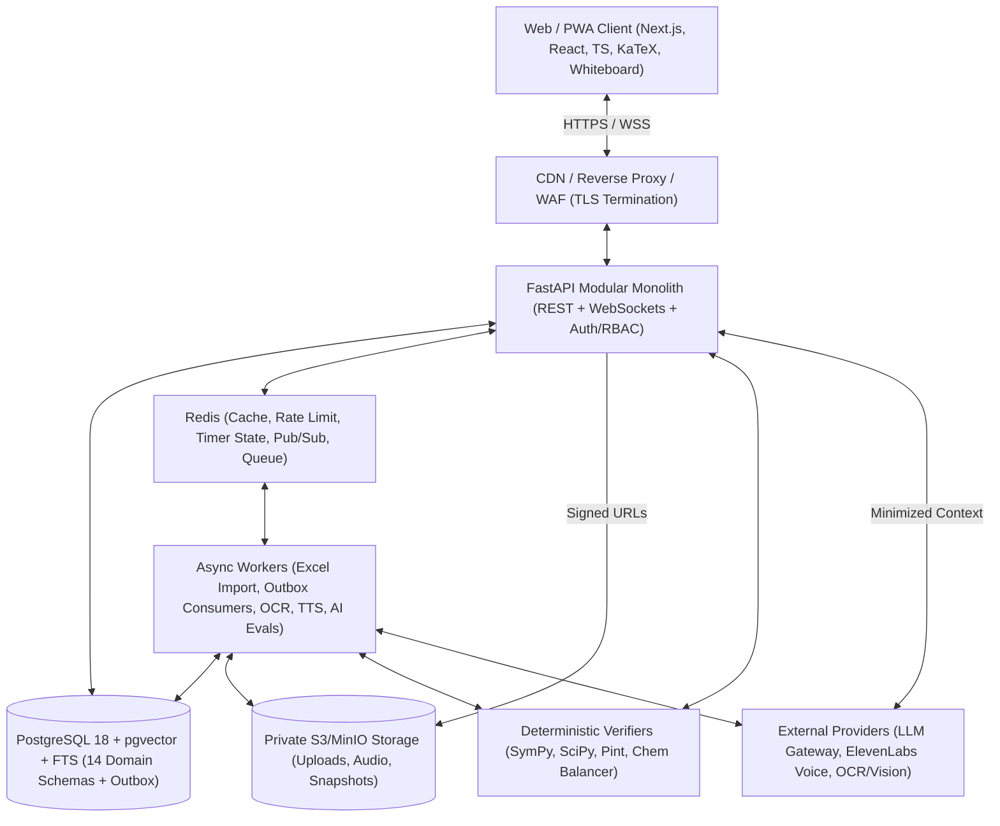
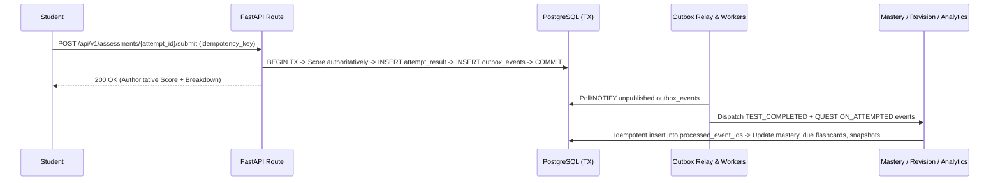

# System Architecture (`docs/ARCHITECTURE.md`)

**Status:** Phase 0 Baseline Proposal  
**Architecture Style:** Modular Monolith (with clean domain boundaries & async workers; selective extraction path later)

---

## 1. Architectural Philosophy & Stack Selection

Because `d:\go4guru` is greenfield (see [PROJECT_AUDIT.md](file:///d:/go4guru/docs/PROJECT_AUDIT.md)), we adopt the Section 38 target stack with documented justification for every layer:

| Layer | Choice | Rationale | Alternatives Considered & Trade-Offs |
| :--- | :--- | :--- | :--- |
| **Frontend Web** | **Next.js (App Router) + React + TypeScript + Tailwind CSS** | SSR/RSC for fast initial page loads on Indian mobile networks, strict TypeScript contracts, rich interactive canvas/classroom state, shared design system across all 8 roles. | Remix/Vite SPA (weaker SEO/SSR for public curriculum/landing pages); separate apps per role (causes UI duplication). |
| **Backend API** | **FastAPI + Python 3.12 + Pydantic v2 + SQLAlchemy 2.0 (async)** | Unified Python ecosystem across REST APIs, WebSockets, AI orchestration, SymPy/SciPy/Pint math verification, OCR, and `pandas`/`openpyxl` Excel ingestion. Automatic OpenAPI 3.1 docs. | Node/NestJS backend (splits AI/SymPy/OCR into a second Python service prematurely, adding IPC latency). |
| **Primary DB** | **PostgreSQL 18** | ACID compliance, strict FK/check constraints, row-level tenant isolation, native `tsvector` FTS, JSONB for extensible question/pattern attributes, already running on host (`postgresql-x64-18`). | MySQL 8 (weaker FTS/JSONB/vector story); MongoDB (poor relational integrity for multi-tenant RBAC, exams, and billing). |
| **Vector Search** | **pgvector** inside PostgreSQL | Hybrid SQL metadata/rights filtering + vector cosine similarity in a single ACID transaction with zero distributed sync drift. | Pinecone/Qdrant/Milvus (premature infra complexity; evaluate only if corpus exceeds ~5–10M chunks). |
| **Cache / Queue** | **Redis** | Sub-millisecond rate limiting, active exam timer state, quota checks, WebSocket pub/sub across API replicas, and job queue broker. | Postgres-only `SKIP LOCKED` queue (viable fallback for tiny dev, weaker for WS pub/sub & rate limiting). |
| **Background Workers** | **Python Worker (`arq` or `celery` over Redis)** | Async processing of Excel ingestion, transactional outbox event consumers (mastery, spaced repetition, analytics), OCR/homework grading, TTS caching, and eval suites. | Inline FastAPI `BackgroundTasks` (not durable across restarts/crashes). |
| **Object Storage** | **S3-Compatible (MinIO local → AWS S3 / GCS / R2 prod)** | Private buckets for Excel uploads, homework images/PDFs, audio cache, whiteboard assets; short-lived signed URLs. | Local filesystem storage (breaks horizontal scaling and backups). |
| **Realtime** | **FastAPI WebSockets + Redis Pub/Sub** | Bi-directional low-latency classroom state sync, live whiteboard events, voice playback markers, doubt interruptions. | Server-Sent Events only (cannot handle bidirectional interactive canvas/interruptions cleanly). |
| **Whiteboard** | **Schema-driven Canvas (`tldraw` vs `Excalidraw` evaluation)** | Structured shape/stroke/math primitives, zero arbitrary code execution, snapshot + event replay. *(Commercial license decision tracked in [WHITEBOARD_SPECIFICATION.md](file:///d:/go4guru/docs/WHITEBOARD_SPECIFICATION.md)).* | Raw HTML5 Canvas from scratch (months of reinvention). |
| **Voice** | **`VoiceProvider` Abstraction → ElevenLabs Initial Adapter** | Decouples classroom & tutor from vendor API; tracks latency, cost, and language capabilities centrally. | Direct ElevenLabs SDK calls in routes (high vendor lock-in). |

---

## 2. High-Level System Topology



---

## 3. Monorepo Layout (`d:\go4guru`)

```text
d:\go4guru\
├── apps\
│   ├── web\                  # Next.js App Router (Role-aware workspaces + Shared UI)
│   ├── api\                  # FastAPI modular monolith (`src/`) + Alembic migrations
│   └── worker\               # Async queue workers & outbox event consumers (`src/go4guru_worker/`)
├── packages\
│   ├── ui\                   # Shared design system components (accessible primitives, KaTeX)
│   ├── contracts\            # Canonical TypeScript API types & shared schemas
│   └── whiteboard-schema\    # Validated structured whiteboard action & classroom event schemas
├── .github\workflows\        # GitHub Actions CI workflows (lint, typecheck, boundaries, tests)
├── infra\
│   └── docker\               # Dockerfiles, compose (Postgres+pgvector, Redis, MinIO)
├── data\
│   └── seeds\                # Clean, rights-verified curriculum & dev fixture seeds (NO third-party PDFs)
├── docs\                     # Architectural, PRD, security, plan, and status docs
└── tests\                    # Cross-app E2E (Playwright), load (Locust/k6), security suites
```

---

## 4. Modular Monolith Boundaries (`apps/api/src/modules/`)

Strict import rules (enforced via `import-linter` / CI checks) prevent circular dependencies:

1. **`identity`** — Auth, JWT/sessions, MFA, users, roles, permissions, parent links, consents.
2. **`organization`** — Tenants, organizations, schools, branches, academic years, classes, sections, enrollments.
3. **`curriculum`** — Boards, sessions, grades, subjects, books, chapters, sections, topics, concepts, objectives, prerequisites, exam mappings.
4. **`content`** — Rights/licenses, CMS items, versions, translations, reviews, publications.
5. **`question_bank`** — Canonical questions, versions, options, solutions, hints, provenance, reviews, Excel staging & import pipeline.
6. **`assessment`** — Practice sessions, quizzes, test blueprints, server-authoritative exam sessions, autosave, idempotent scoring, rubrics.
7. **`learning`** — Outbox event consumers, concept mastery, misconceptions, adaptive paths, recommendations.
8. **`revision`** — Flashcards, spaced repetition schedules, review logs, study plans.
9. **`ai`** — Intent router, context/curriculum resolvers, hybrid RAG, teaching planner, SymPy/Pint verifier, safety layer, evaluation runner.
10. **`classroom`** — Structured lesson schema, classroom state machine, WebSocket room hub, whiteboard event/snapshot persistence, voice adapter interface.
11. **`homework`** — Upload validation, OCR orchestration, step analysis, graduated hint workflows.
12. **`teacher`** — Teacher classes, assignments, AI-assisted rubric grading + overrides, cohort reports.
13. **`mentor`** — Mentee portfolios, goals, mentoring session notes, interventions, alerts.
14. **`billing`** — Plans, entitlements, deterministic quota engine, payment provider adapter, invoices, usage cost rollups.
15. **`analytics`** — Learning vs product event ingestion, materialized daily/hourly snapshots.
16. **`notifications`** — Multi-channel templates, quiet hours, delivery outbox.

**Cross-Module Communication Rules:**
- Modules expose explicit internal Python service/query interfaces (`public.py` / `contracts.py`); direct cross-module table joins or ORM model imports across write boundaries are forbidden.
- Async reactions (e.g., `TEST_COMPLETED → update mastery & revision queue & analytics`) MUST go through the **Transactional Outbox** (`outbox_events` written in the same DB transaction as the business mutation).

---

## 5. Event-Driven Learning Pipeline



---

## 6. Future Service Extraction Criteria

Extract a module (`ai`, `classroom`, `ingestion`, `analytics`) into an independent service ONLY when triggered by measurable thresholds:
- AI/Voice orchestration worker pools require independent GPU/autoscaling or isolation from transactional P95 API latency.
- Concurrent WebSocket classroom rooms saturate single-cluster connection limits despite Redis Pub/Sub horizontal API scaling.
- Independent team ownership or release cadence demands separate deployment pipelines.
