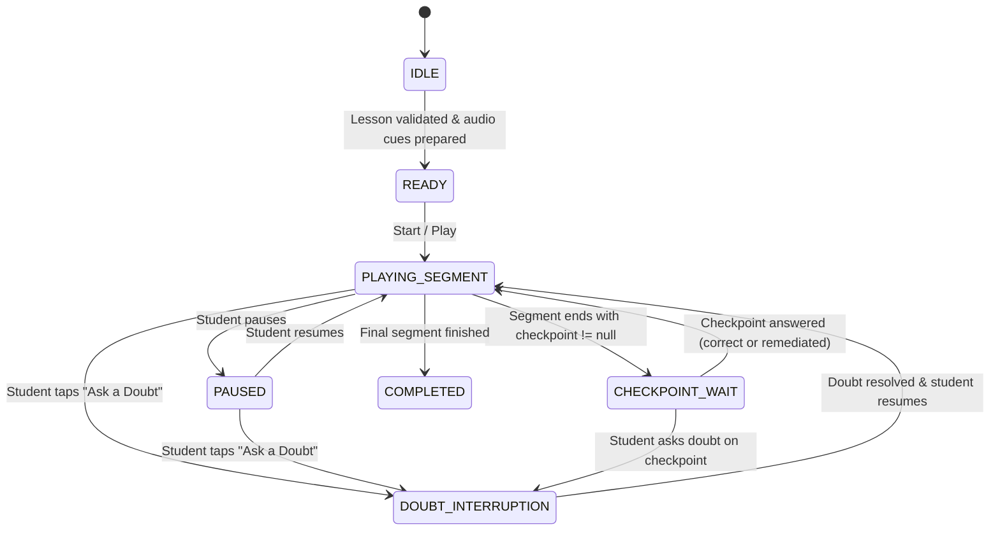

# Interactive Live AI Classroom Architecture (`docs/CLASSROOM_ARCHITECTURE.md`)

**Design Goal:** Transform AI teaching from an unstructured text stream into a deterministic, server-orchestrated, pause/resume/interruptible audio-visual classroom experience.

---

## 1. Structured Lesson Artifact Schema (`lesson_plans.lesson_artifact_jsonb`)

Every live lesson is generated, schema-validated (JSON Schema / Pydantic v2), and persisted before playback begins:

```json
{
  "schema_version": "1.0.0",
  "lesson_id": "01936a8b-...",
  "student_id": "01936a10-...",
  "curriculum_context": {
    "board": "CBSE",
    "academic_session": "2026-27",
    "grade": 10,
    "subject": "Physics",
    "chapter_id": "...",
    "concept_id": "..."
  },
  "language": "en",
  "voice_language": "en",
  "subtitle_language": "hi",
  "objectives": [
    "State Snell's law of refraction",
    "Calculate refractive index from angles of incidence and refraction"
  ],
  "segments": [
    {
      "sequence": 1,
      "type": "concept_explanation",
      "title": "Why Light Bends Across Media",
      "narration": "When a ray of light travels obliquely from air into glass, its speed decreases...",
      "subtitle_cues": [
        {"start_ms": 0, "end_ms": 3200, "text": "When a ray of light travels obliquely from air into glass..."}
      ],
      "canvas_actions": [
        {"op": "DRAW_LINE", "id": "boundary_1", "x1": 100, "y1": 300, "x2": 700, "y2": 300, "style": "dashed"},
        {"op": "DRAW_ARROW", "id": "ray_in", "x1": 200, "y1": 120, "x2": 400, "y2": 300, "at_ms": 1200},
        {"op": "INSERT_FORMULA", "id": "snell_1", "latex": "n_1 \\sin i = n_2 \\sin r", "x": 450, "y": 140, "at_ms": 3500}
      ],
      "checkpoint": null,
      "duration_ms": 18000
    },
    {
      "sequence": 2,
      "type": "checkpoint_question",
      "title": "Quick Check",
      "narration": "Before we solve a numerical, check what happens when light enters glass from air.",
      "canvas_actions": [],
      "checkpoint": {
        "question_type": "mcq_single",
        "prompt": "Light bends towards the normal when entering glass from air because:",
        "options": [{"key": "A", "text": "Speed increases"}, {"key": "B", "text": "Speed decreases"}],
        "correct_key": "B",
        "remediation_hint": "Remember glass is optically denser than air."
      },
      "duration_ms": 10000
    }
  ]
}
```

---

## 2. Server-Controlled Classroom State Machine

Client UI acts purely as a synchronized renderer & controller; **the server owns classroom state**:



### Supported Playback & Control Transitions
- **Play / Pause / Resume:** Updates server timestamp & `state`; broadcasts state ack via WebSocket.
- **Repeat Segment / Previous / Next / Skip:** Updates `current_segment_seq`, sends deterministic whiteboard snapshot + delta actions up to that segment so the board is always consistent.
- **Speed Control (`0.75x .. 1.75x`) & Language Control:** Persists on `classroom_sessions`; switching voice/subtitle language re-renders subsequent segment audio/subtitles via Language Capability Registry.
- **Doubt Interruption:** Freezes segment clock & whiteboard state → Opens scoped AI Tutor sub-turn grounded in `current_segment` + `concept_id` (optionally pushes temporary clarification actions onto an overlay layer) → Cleanly restores lesson segment upon resume.
- **Save & Resume Across Devices:** Every state transition and checkpoint answer persists in `classroom_sessions` + `classroom_events`; reconnecting client fetches `GET /api/v1/classroom/sessions/{id}` + latest `whiteboard_snapshot` and picks up seamlessly.

---

## 3. Audio-Visual Synchronization Protocol (WebSocket `/ws/v1/classroom/{session_id}`)

1. Segment starts → Server sends `segment.start` containing `segment_seq`, audio stream URL (or chunked base64/binary frames), `subtitle_cues[]`, and timed `canvas_actions[]` (`at_ms` offsets relative to audio playback head).
2. Client synchronizes whiteboard animations and subtitle highlights against `<audio>` `currentTime * 1000` (eliminating network jitter drift).
3. If Voice provider is degraded or language is text-only in Capability Registry, client automatically runs a smooth timed-reading fallback clock using `duration_ms` and highlights narration text + subtitles cleanly.
