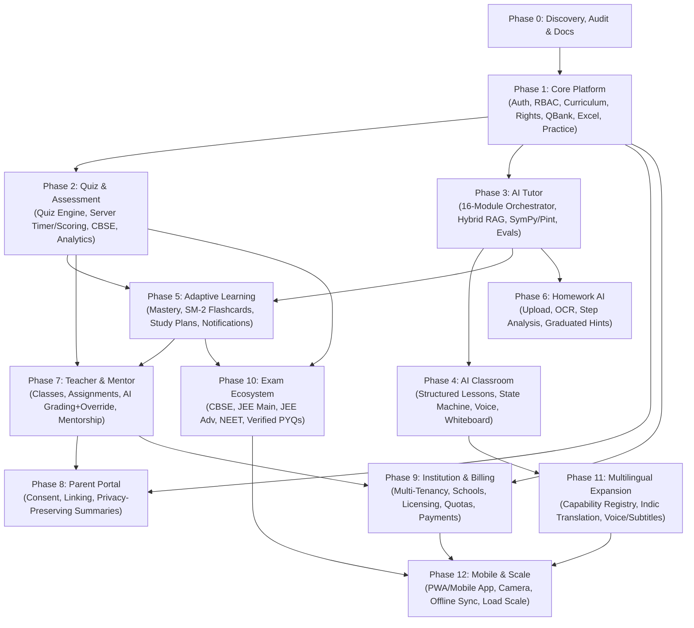

# Phased Implementation Roadmap & Dependency Map (`docs/ROADMAP.md`)

**Sequence Enforced:** `DISCOVER → AUDIT → SPECIFY → DESIGN → PLAN → IMPLEMENT → TEST → REVIEW → DOCUMENT → RELEASE`

---

## 1. Cross-Phase Dependency Map

---

## 2. Detailed Phase Breakdown

| Phase | Scope & Deliverables | Dependencies | Primary Acceptance & Test Gate | Risks |
| :--- | :--- | :--- | :--- | :--- |
| **Phase 0** *(Current)* | Repo & Data Audit, 25 `docs/*` specs, PRD, Master Checklist, Architecture, Decision Log | None | All 25 docs authored cleanly with zero fabricated repo facts | Missing Excel assets & local Redis/pgvector |
| **Phase 1** | Git init, monorepo, DB core migrations, Auth + RBAC + MFA, Data-driven Curriculum (6–12), Rights CMS, Canonical QBank, 14-stage Excel Importer, Practice, Notes/Bookmarks, Student Core Dashboard, Audit Logs | Phase 0 sign-off; PG + Redis | Auth/RBAC matrix tests, Excel staging/rollback tests, rights quarantine gate, practice + notes E2E | Unlicensed PDFs accidentally used; Excel columns vary |
| **Phase 2** | Quiz Engine (12 types), Server-authoritative Test Engine (UTC timer, autosave, idempotent scoring, negative marking), CBSE initial workflows, Learning Events Outbox & Snapshots | Phase 1 | Client timer/score tamper tests, duplicate submit idempotency, CBSE rubric unit tests | Clock drift / autosave race conditions |
| **Phase 3** | 16-module AI Orchestrator, PII-minimized Context, Hybrid pgvector+FTS RAG (rights-filtered), 10-mode Tutor + anti-spoiler, SymPy/Pint/Chem Verifier, AI Eval runner & Review Queue, Cost ledger | Phase 1 + `pgvector` | Math verifier unit tests, RAG rights isolation tests, Turn-1 Socratic anti-spoiler + redteam eval pass | LLM math errors, RAG latency, token burn |
| **Phase 4** | Structured Lesson JSON & Validator, Server Classroom State Machine, WebSocket hub, Schema Whiteboard (`tldraw`/`Excalidraw`) + replay, `VoiceProvider` + ElevenLabs adapter, Captions/Transcript | Phase 3 | Invalid whiteboard/lesson schema rejected, WS reconnect state recovery, ElevenLabs degraded fallback test | `tldraw` commercial licensing; AV sync drift |
| **Phase 5** | Outbox Mastery Engine (explainable rule model v1), Weak concept remediation loop, Multi-modal Flashcards & SM-2 Spaced Repetition, Study Planner, Multi-channel Notifications | Phase 2 & 3 | Idempotent outbox replay test, SM-2 interval tests, study plan prerequisite constraint tests | Noisy mastery estimates on small N |
| **Phase 6** | Multi-page Image/PDF Homework upload, MIME/malware validation, OCR + Vision extraction, Subject-specific step error analyzer + Verifier, Graduated 3-level hints, Retry flow | Phase 3 | Malware/MIME rejection, math sign-error detection + Level-1 anti-spoiler verification | Poor student handwriting OCR quality |
| **Phase 7** | Teacher Classes/Sections, Assignment/Test Builder, AI-assisted rubric grading + mandatory human override & audit, Class heatmaps, Mentor portfolio/sessions/goals/interventions | Phase 2 & 5 | Teacher cross-class 403 tests, AI override audit log test, Mentor isolation tests | Teacher grading workload UX friction |
| **Phase 8** | Minor age-gate & verifiable guardian consent workflow, Consent withdrawal, Parent Dashboard with privacy-preserving summaries (raw AI chats blocked), Notification controls | Phase 1 & 7 | Parent blocked from `ai_messages` (403), consent revocation enforcement, DPDP pre-review | Legal DPDP rule shifts |
| **Phase 9** | Multi-tenant Orgs/Schools/Branches/Academic Years/Enrollments, Institutional tests & analytics, Configurable Plans/Entitlements, Quota engine, Payment Provider Adapter & Invoices | Phase 1 & 7 | Cross-tenant isolation fuzz tests across all endpoints, idempotent payment webhook & quota block tests | Tenant data leak if query misses `tenant_id` |
| **Phase 10** | Full CBSE Competency/Case Prep, JEE Main CBT (session/shift PYQs, numerical tolerance), JEE Advanced (partial marking/matrix/multi-concept), NEET (Botany/Zoology, NCERT mapping) | Phase 2 & 5 | JEE Adv subset partial-marking tests, verified PYQ provenance constraint checks | Sourcing verified non-copyrighted PYQ banks |
| **Phase 11** | Language Capability Registry UI/API enforcement, Independent 6-dim language prefs, Bilingual STEM glossaries, Regional Indic translations + human review, Regional TTS/STT adapters | Phase 4 | Unsupported TTS hidden/flagged by registry, LaTeX preserved across translations, RTL UI check | Low TTS/STT quality in regional STEM terms |
| **Phase 12** | Mobile PWA/Native client, Camera homework capture, Push-to-talk voice, IndexedDB/SQLite offline flashcard sync, 10k concurrent load & chaos testing, Cloud infra optimization | Phase 9, 10, 11 | Offline conflict-safe sync test, k6/Locust load SLOs, mobile WCAG tap-target audit | Bandwidth constraints on 3G networks |

---

## 3. Recommended Next Implementation Phase

Proceed immediately to **Phase 1 — Core Platform** upon confirmation of the Phase 0 decisions in [DECISION_LOG.md](file:///d:/go4guru/docs/DECISION_LOG.md) (local Redis/pgvector setup, initial seed data strategy, and approval of the Next.js + FastAPI + PostgreSQL 18 monorepo).
